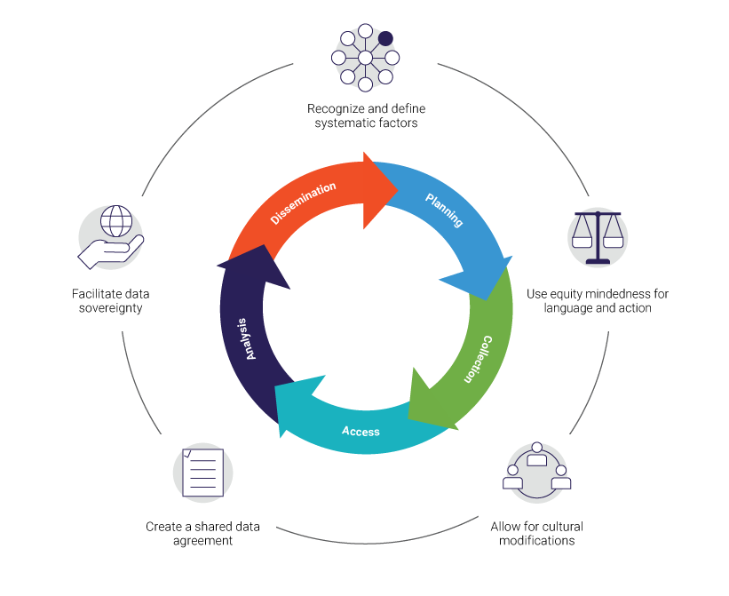
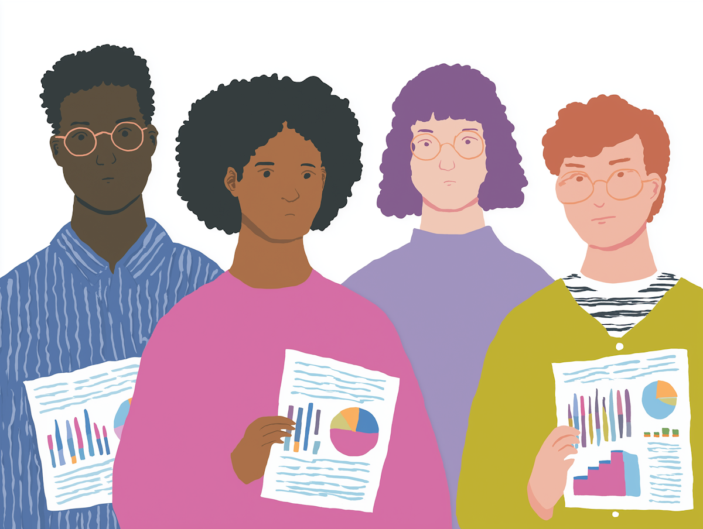
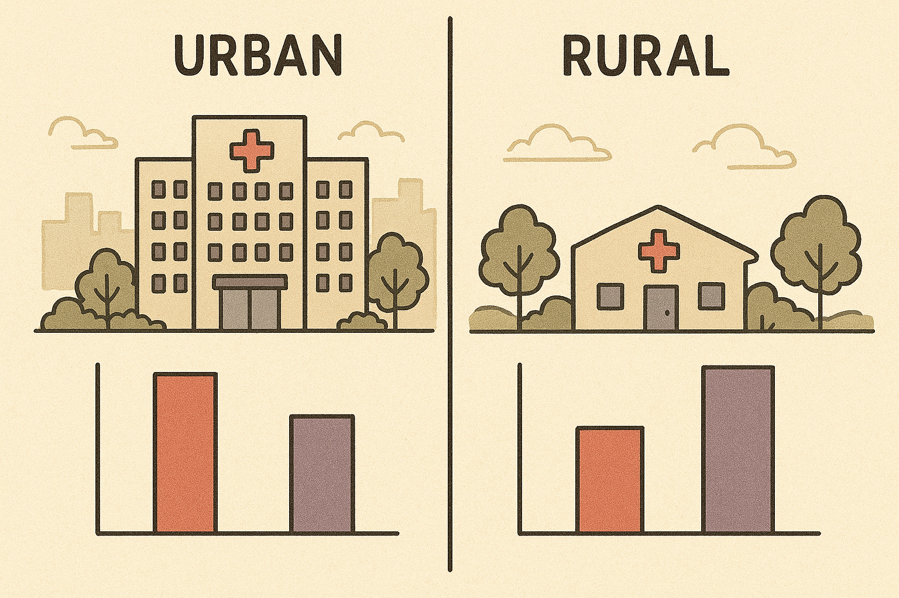
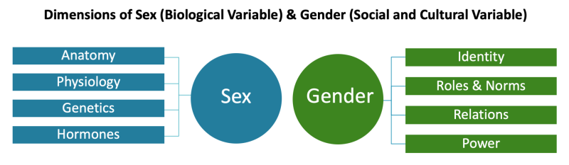
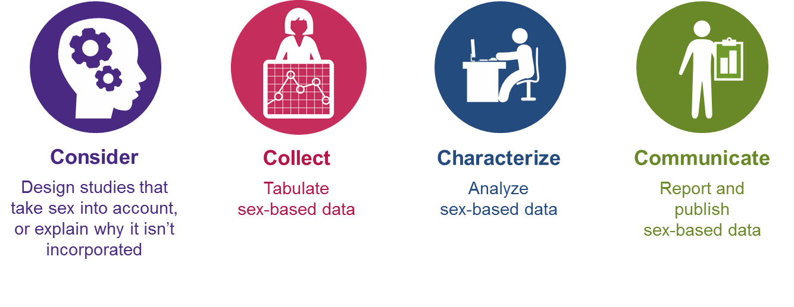
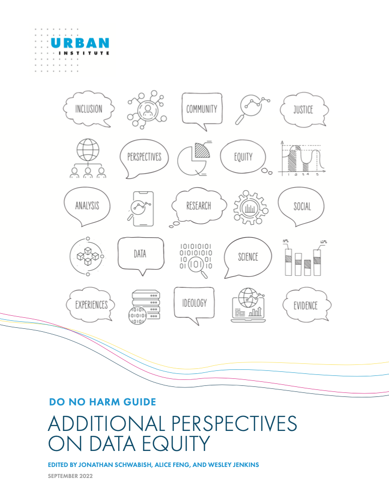

```{r}
#| label: "setup"
#| include: false
#| message: false
#| warning: false

library(tidyverse)
library(RefManageR)
BibOptions(check.entries = FALSE,
           bib.style = "authoryear",
           cite.style = "alphabetic",
           style = "markdown",
           hyperlink = TRUE,
           dashed = FALSE)
myBib <- ReadBib(here::here("2026_11_HIP523_DataEquity", "minnier_bibliography.bib"), check = FALSE)
# short in-text citations ("Sax et al. (2023)"); the reference list keeps full author lists
cite <- function(key) {
  n_auth <- length(myBib[[key]]$author)
  Cite(key = key, bib = myBib, textual = TRUE,
       .opts = list(cite.style = "authoryear", max.names = if (n_auth <= 2) 2 else 1,
                    longnamesfirst = FALSE))
}
```

## Learning Objectives

By the end of this session, you'll be able to:

-   Describe what data equity means for EHR and real-world data
-   Recognize common sources of bias in how race, sex, gender, and SDOH are recorded
-   Decide what to adjust for when the question is about a disparity
-   Read "we adjusted for race" with a critical eye

:::{.notes}
- Hi everyone, thanks for having me for the last session of the course. I'm Jessica Minnier, a biostatistician at the Knight Cancer Institute.
- Today: data equity in clinical research. It's a vague term, so I'll start by defining it.
- Then how we think about race, sex, gender, and SDOH (social determinants of health) when we design studies and analyze data.
- Most of the time goes to the last two objectives: what to put in the model, with examples and an app.
:::

## Where This Fits in HIP 523

Earlier in this course:

-   EHR data and data quality: missing and miscoded data aren't spread evenly across patients
-   TriNetX & Cosmos: race, ethnicity, and SDOH come in categories someone else picked
-   The research data lifecycle: equity questions come up at every step, from design to sharing
-   Algorithmic fairness: prediction models can work worse for some groups

Today I'll focus on the regression side: how we use models to **measure and explain disparities**, and how the choice of what to adjust for changes the answer.

:::{.notes}
- You've already seen a lot of the pieces of this.
- When you looked at EHR data quality, think about who the missing data belong to. It usually isn't random.
- If you've pulled a cohort from TriNetX or Cosmos, the race and ethnicity categories were decided before you got there.
- Rumel covered prediction and fairness, so I'll mostly stay on the inference side. The last tab of the app connects back to his talk.
:::

# What is Data Equity?

[{fig-alt="Pieces of yellow lego does not equal diverse lego people" height=480}](https://lib.guides.umd.edu/ResearchEquity/DataEquity)

:::{.notes}
- Let's start with the basic question: what is data equity?
- If anyone has an idea, put it in the chat.
- One way to think about it: populations aren't homogeneous, and some subgroups have been historically marginalized and understudied in health research.
:::

## What is Data Equity?

-   Paying attention to power, bias, and discrimination in how data are collected, analyzed, interpreted, and used
-   Making sure research benefits everyone, especially groups that have been left out
-   Data aren't neutral. They reflect the systems and biases they came from
-   Communities and patients have a say in the research, and ideally ownership of their own data (data sovereignty; see the [CARE Principles](https://www.gida-global.org/care))
-   The goal: results that are fair, accurate, and useful for reducing disparities

::: {.vsmall}
Sources: [Community Commons](https://www.communitycommons.org/collections/An-Introduction-to-Data-Equity), [CDC Foundation](https://www.cdcfoundation.org/HealthEquity/data-equity-principles), [UMD Library Guide](https://lib.guides.umd.edu/ResearchEquity/DataEquity), [Data.org](https://data.org/resources/what-is-data-equity-and-why-does-it-matter/), `r cite("carroll2020care")`
:::

:::{.notes}
- Data equity is paying attention to power, bias, and discrimination in how we collect, analyze, interpret, and use data.
- Making sure research benefits everyone, especially groups who have been left out.
- Data isn't neutral. It reflects the social structures and biases it came from.
- Community participation and trust, with the goal of data sovereignty, where communities own their own data. The CARE principles were written for Indigenous data. This ties back to the data sharing session.
- In the end we want results that are sound, fair, and useful.
:::

## Data Equity Principles

[{fig-alt="CDC Foundation Data Equity Principles" height=530}](https://www.cdcfoundation.org/data-equity-principles?inline)

:::{.notes}
- The CDC Foundation lays out a life cycle for data equity.
- Equity applies across the whole process: purpose, collection, analysis, and sharing and acting on findings.
- Same idea as the research data lifecycle you saw earlier in the course.
:::

# What is Equity-minded Research?

{height=420}

[Lummi.ai](https://www.lummi.ai/illustration/data-presentation-team-x1xh7)

:::{.notes}
- What does equity-minded research look like in practice?
- If you have an example, put it in the chat.
:::

## Equity-minded Research

-   Name the systemic factors that could shape your outcome: access, insurance, neighborhood, discrimination
-   Collect data inclusively: interpreters, self-reported race and gender, more than two categories
-   [Sample](https://www.nature.com/articles/s41591-023-02665-1) so the groups you care about are represented
-   Reflect on your own position and assumptions ([positionality](https://www.urban.org/research/publication/exploring-individual-and-institutional-positionality))
-   Interpret in context: a difference by race is a reason to ask why
-   Report results by subgroup, and say what you couldn't measure

::: {.vsmall}
Sources: `r cite("venkateswaran2023bringing")`; `r cite("retzer2023toolkit")`
:::

:::{.notes}
- Some concrete versions of equity-minded research.
- Start by naming the systemic factors that could affect your outcome.
- Collect data so people can actually be counted: interpreters, self-report, more than two options.
- Positionality: reflecting on our own biases, assumptions, and experiences, and how they shape what we study.
- When you see a difference by race, that's the start of the question.
- Report by subgroup, and be upfront about what you couldn't measure.
:::

## Common Data Equity Challenges in EHR Data

:::: columns
::: {.column width="60%"}
-   Selection bias: the EHR only sees patients who come in
    -   Ex: rural patients who come to an academic center only for specialty care
-   Missing data isn't random
    -   Ex: race recorded as "Unknown" or "Declined"; interpreter need not documented
-   Where did the value come from?
    -   Ex: race self-reported by the patient vs. entered by a registrar
:::

::: {.column width="40%"}

:::
::::

:::{.notes}
- Some common hurdles, with EHR examples since that's what you've been working with.
- Selection bias. The EHR only has the patients who come in. People with good access have more visits and more data.
- Missing data. Race shows up as Unknown or Declined, or interpreter need isn't documented.
- If we drop those patients (complete-case analysis), we're dropping a non-random group.
- Imputing race isn't a free fix either. Methods that guess race from surname and address work worse for some groups.
- Ask where a field came from. Self-report and a registrar's guess are not the same variable.
:::

## Aggregation and Small Groups

-   Collapsing groups can hide disparities
    -   Ex: Asian American subgroups ([Haelle 2022](https://healthjournalism.org/blog/2022/08/how-improper-aggregation-of-racial-ethnic-groups-in-research-can-mask-health-disparities/))
    -   Ex: asthma prevalence differs for US-born and non-US-born Latinos `r cite("marino2023disaggregating")`
-   Small groups: report them with confidence intervals instead of collapsing by default
    -   Multilevel models can help `r cite("evans2018multilevel")`

:::{.notes}
- Collapsing all Asian American subgroups can hide big differences, say between Vietnamese and Japanese patients.
- We saw something similar in our own work with asthma in US-born and non-US-born Latinos.
- When groups get small, the instinct is to collapse them. Try reporting them with wide confidence intervals instead.
- Multilevel models can borrow strength across groups. One approach for intersectional groups is called MAIHDA (Evans and colleagues).
:::

## Missing Context and History

-   Lack of contextual variables
    -   Ex: post-op complications with patient factors but no hospital factors, like nurse staffing
    -   Ex: asthma prevalence without air quality or housing conditions
-   History of unethical research and misuse of demographic data
    -   Harmful research on Black Americans has led to justified mistrust and underrepresentation in studies
    -   The Tuskegee syphilis study is one example `r cite("katz2006tuskegee")`

:::{.notes}
- Missing context. A post-op study that only has patient factors misses hospital factors like staffing.
- Or asthma without air quality or housing.
- History. Tuskegee and many other studies created a justified mistrust of research in Black communities, which shows up today as underrepresentation.
- Acknowledging that history is part of rebuilding trust.
:::

# Sex and Gender Considerations

{height=420}

[NIH Sex and Gender](https://orwh.od.nih.gov/sex-gender)

:::{.notes}
- Now a specific area: sex and gender.
:::

## Sex and Gender in Research {.small}

:::: columns
::: {.column width="55%"}
-   Sex (biological) and gender (social) are different variables
    -   EHR "sex" fields often mix sex assigned at birth, legal sex, and gender identity
-   Don't assume a binary; document missing data
-   NIH policy on [Sex as a Biological Variable (SABV, 2016)](https://orwh.od.nih.gov/sex-gender/orwh-mission-area-sex-gender-in-research/nih-policy-on-sex-as-biological-variable):
    -   adequate sample sizes for all sexes
    -   test for sex-specific effects
    -   report sex-disaggregated results
-   Common pitfalls: too few women; transgender and intersex people left out; interactions ignored
:::

::: {.column width="45%"}
{fig-alt="NIH 4 Cs of Studying SABV"}
:::
::::

:::{.notes}
- Sex is biological, gender is social. They get used interchangeably, and that's a common mistake.
- In EHR data, check what the field actually is. Many systems have one "sex" field that mixes sex assigned at birth, legal sex, and gender identity. Newer systems have separate sexual orientation and gender identity (SOGI) fields, but they're often blank.
- In 2016 NIH started the SABV policy: account for sex in design, analysis, and reporting.
- In practice: enough people of each sex, test for sex-specific effects, report results by sex.
- NIH's "4 Cs" on the right: Consider, Collect, Characterize, Communicate.
- Historically, women were underrepresented, and transgender and intersex people were left out almost entirely.
:::

# Race and Ethnicity in Research

> Race is a social construct, commonly used in epidemiologic research to adjust for confounding. However, adjustment of race may mask racial disparities, thereby perpetuating structural racism.

"We adjusted for race": now what? A systematic review... `r cite("swilley2023we")`

:::{.notes}
- One of the most complex topics today: race and ethnicity.
- This quote from a recent systematic review sets it up well. Read it.
:::

## Race and Ethnicity: Critical Considerations

-   Race is a social construct, not biological
-   There's more variation within groups than between them
-   Racial categories have a history, and they've changed over time
-   Ask what the race variable stands for in your study: exposure to racism, culture, ancestry, or something else
-   Race intersects with other variables (sex, income, language)

:::{.notes}
- Race is a social construct. Genetic variation within groups is larger than between groups.
- When we see health differences by race, we're usually seeing the downstream effects of racism, poverty, and environment.
- So be clear about what the race variable stands for in your study. That decides how you should use it in a model.
:::

## Race and Ethnicity: Recommendations

-   Use clearly defined categories; don't collapse groups with different outcomes
    -   Avoid "Other"; describe what a collapsed category contains
    -   Include ethnicity and ancestry information
-   Document how race and ethnicity were collected and classified
-   The 2024 federal standard (OMB SPD 15) combines race and ethnicity into one question and adds Middle Eastern or North African. EHR categories will change
-   If race is in the model, check whether effects differ by race (effect modification)
-   Acknowledge limitations

::: {.vsmall}
[Urban Institute: Using Race and Ethnicity Data to Advance Health Equity](https://www.urban.org/research/publication/using-race-and-ethnicity-data-advance-health-equity); `r cite("swilley2023we")`
:::

:::{.notes}
- Use clearly defined categories, and don't collapse them when groups have different outcomes.
- "Other" is a problem label. Describe what's in a collapsed group.
- Document how the data were collected.
- The federal standard changed in 2024. Race and ethnicity become one question, and there's a new Middle Eastern or North African category. Agencies have until 2029 to switch, so a multi-year dataset may change categories partway through.
- If you use race in a model, check for effect modification. Tab 4 of the app shows what that looks like.
- And always acknowledge the limits of the variables you have.
:::

## Race in Clinical Algorithms and Measurement

Bias can be built into EHR values before any analysis happens.

-   Kidney function: a race term in eGFR made Black patients' kidneys look healthier, delaying referral and transplant listing. Removed in 2021 `r cite("inker2021new")`
-   Pulse oximetry reads high in darker skin; hidden low oxygen was missed about 3 times as often in Black patients `r cite("sjoding2020racial")`
-   Race correction shows up in calculators across many specialties `r cite("vyas2020hidden")`
-   Models built on these values inherit the bias (app tab 5)

:::{.notes}
- Some bias is already in the numbers before we touch them.
- eGFR used to have a race multiplier. Black patients looked like they had better kidney function than they did, and that delayed nephrology referral and transplant listing. The 2021 CKD-EPI equation dropped race.
- Pulse oximeters read high in patients with darker skin. Sjoding found occult hypoxemia was missed about three times as often in Black patients.
- Vyas and colleagues found race corrections in cardiology, obstetrics, urology, pulmonology, and more.
- If you build a prediction model on these values, the bias comes along. That's what Rumel talked about, and the last tab of the app lets you play with it.
:::

# Social Determinants of Health (SDOH)

{height=340}

[US Dept of Health & Human Services: Healthy People 2030](https://odphp.health.gov/healthypeople/priority-areas/social-determinants-health)

:::{.notes}
- Race as a social construct leads to SDOH.
- Healthy People 2030 defines SDOH as the conditions where people are born, live, learn, work, and play that affect health.
- Economic stability, education, healthcare access, neighborhood. These are often the real drivers of disparities we attribute to race.
:::

## SDOH: Data Considerations

:::: columns
::: {.column width="58%"}
-   Equitable sampling; granular, standardized definitions
-   Often missing in the EHR
    -   ICD-10 Z-codes for social needs (e.g., housing instability) are often left blank
-   Area-level measures linked by address
    -   Area Deprivation Index (ADI), Social Vulnerability Index (SVI)
    -   They describe the neighborhood, not the person (ecological fallacy)
:::

::: {.column width="42%"}
{height=400}
:::
::::

:::{.notes}
- SDOH in our data is hard to get.
- There are ICD Z-codes for things like housing instability or food insecurity, but they're often not entered.
- So we often link area-level measures like ADI or SVI by address. Useful, but they describe the neighborhood. Not everyone in a high-ADI neighborhood is low income. Assuming they are is the ecological fallacy.
:::

## SDOH: Analysis Considerations

-   Including SDOH variables in models can be complex
-   For each one, ask: is it a confounder, a mediator, or an effect modifier?
-   SDOH variables are correlated with each other (income, education, neighborhood)
-   Address missing data

`r cite("braveman2023social")`

:::{.notes}
- Once SDOH is in the data, how do we use it?
- The key question for each variable: is it a confounder, a mediator, or an effect modifier? We'll define those in a minute, and the examples are built around this question.
- Many SDOH variables are correlated, so watch for collinearity.
- And think about missing data before dropping people.
:::

## Statistical Analysis: What Does "Adjusted For" Mean?

What does controlling for race (or sex, or gender, or SDOH) mean?

-   Adjustment, matching, and stratification estimate the effect within groups, then combine them
    -   Ex: compare statin rates by insurance within each age group, then average
-   The combined effect is weighted toward the larger groups
-   Adjusting for race compares people within race groups. It does not remove the effects of racism, and it can hide them
-   Effect modification: let the effect differ by group instead of averaging

`r cite("swilley2023we")`

:::{.notes}
- When we say we "adjusted for" something, what do we mean?
- Adjustment estimates the effect within groups and then averages. Example: compare statin rates by insurance within each age group, then combine.
- That average leans toward the bigger groups, which can hide a different effect in a smaller group.
- When we adjust for race, we're comparing people within race groups. That doesn't take racism out of the picture, and if the exposure itself is shaped by racism, adjusting can hide part of the effect.
- Effect modification lets us estimate effects separately by group, which is often more useful.
:::

## Confounder or Mediator?

**Confounder:** comes before the attribute and affects the outcome. Usually adjust for it.

::: {.diagram}
Age → Insurance (Medicaid vs. private)

Age → Statin prescribed
:::

**Mediator (a post-attribute variable):** is affected by the attribute and is on the path to the outcome. Adjusting for it removes that path from the estimate.

::: {.diagram}
Race → Triage acuity → Opioid analgesia
:::

The attribute is the characteristic we're asking about disparities by (race, insurance, language).

:::{.notes}
- Two words we'll use for the rest of the talk.
- A confounder comes first. Age affects which insurance you have and whether you get a statin. Insurance doesn't change your age. So adjust for age.
- A mediator comes after. If race affects how acutely you're triaged, and triage affects what pain medication you get, triage is a mediator. Adjust for it and you remove that part of the disparity.
- "Attribute" is just the word for the thing we're comparing groups on.
:::

## Modeling Decisions

**Bivariate Model: Y~X**

- Use when asking "Does a demographic group receive access at different rates?"
- This is the **total disparity**

**Multiple Regression Y~X+Z**

- Use when asking "Do similarly situated individuals access benefits at the same rate?"
- This is the **residual disparity** after adjusting for Z. Which Z's belong in the model (confounders, not mediators) depends on the question

::: {.vsmall}
`r cite("duan2008disparities")`; `r cite("jackson2018decomposition")`
:::

:::{.notes}
- Bivariate model, Y on X, where X is something like race: "does a disparity exist?" This is often the first and most important question. It's the total disparity.
- Multiple regression, Y on X plus other variables Z: "do similar people still get different outcomes?" That's the residual disparity.
- What goes into Z matters. Confounders are usually fine. Mediators can hide the disparity.
- For those who want more, Jackson and VanderWeele frame this as a decomposition: how much of a disparity would remain if we fixed a mediator.
:::

## Characterizing Confounding

When race is the confounder, what kind of confounding is it?

1. **Discriminatory:** effects on the exposure and outcome are due to individual or systemic discrimination
2. **Sociocultural:** effects are due to personal or cultural practices
3. **Biological:** effects are directly due to biological mechanisms

The type changes how to interpret an adjusted estimate `r cite("swilley2023we")`

:::{.notes}
- Swilley and colleagues describe three kinds of confounding when race is the confounder.
- Discriminatory: race affects the exposure and outcome through discrimination.
- Sociocultural: through personal or cultural practices.
- Biological: directly through biology. This is rarer than it's assumed to be.
- If the confounding is discriminatory, "adjusting for race" can adjust away the very thing you should be reporting.
:::

# Modeling Examples

[Interactive App: minnier.shinyapps.io/equity_regression](https://minnier.shinyapps.io/equity_regression/)

{height=380}

:::{.notes}
- Three examples, all EHR-style data. The data in the app are simulated, so we know the right answer.
- I'll go back and forth between the slides and the app.
:::

## Example 1: Opioid Analgesia in the ED {.small}

-   **Research Question:** Among ED visits for a long-bone fracture, are Black patients less likely to receive opioid analgesia?
    -   Real studies find they are: pooled OR 0.60 for analgesia, Black vs. White patients `r cite("lee2019racial")`
-   **Outcome (Y):** Received opioid analgesia (yes/no)
-   **Attribute of Interest (X):** Patient race (Black vs. White)

:::: columns
::: {.column width="50%"}
***Bivariate Regression Model:***

`glm(analgesia ~ race, binomial, data = ed)`

**Interpretation:** "On average, are Black patients less likely to get opioid analgesia than White patients?"
:::

::: {.column width="50%"}
***Multiple Regression Model:***

`glm(analgesia ~ race + triage_acuity, binomial, data = ed)`

**Interpretation:** "Among patients with the same triage acuity, is there still a difference?" (Triage acuity = Emergency Severity Index, ESI, 1 = most urgent)
:::
::::

:::{.notes}
- This is a real, well-documented disparity. A meta-analysis found Black patients had about 0.6 times the odds of getting analgesia for acute pain in the ED. The app's default lands near 0.7.
- Outcome: did the patient get opioid analgesia. Attribute: race.
- Bivariate model: on average, are Black patients less likely to get it?
- Multiple regression adds triage acuity, the ESI level the triage nurse assigns. Among patients with the same acuity, is there still a gap?
- Switch to the app, tab 1.
:::

## Discussion: Post-attribute Bias {.small}

::: {.takeaway}
Adjusting for a step where bias happens can hide the bias.
:::

-   Triage acuity is assigned by a person, and Black patients are more often under-triaged `r cite("schrader2013racial")`; `r cite("sax2023evaluation")`
-   If race affects triage, and triage affects treatment, adjusting for triage removes that part of the disparity
-   The bivariate model may be more appropriate. Here the "race" effect could be the effect of systemic racism

**Post-attribute bias** occurs when we control for variables that may be affected by the attribute we're studying (a.k.a. post-treatment bias, intermediate variable bias, mediating variable bias)

:::{.notes}
- Triage acuity looks like a reasonable thing to adjust for. Sicker patients should get more treatment.
- But acuity is assigned by a person, and there's evidence it's biased by race. Sax and colleagues looked at 5 million Kaiser ED visits and found Black patients had about 18% higher risk of being under-triaged. Joseph and colleagues found similar patterns for Black, Hispanic, and non-English-speaking patients.
- If bias lowers triage acuity for Black patients, and acuity drives treatment, adjusting for acuity takes that part of the disparity out of the estimate.
- In the app: with all the bias at triage, the adjusted odds ratio sits near 1. Prescribing looks fair, and patients still weren't treated fairly.
- Here the bivariate model is the more honest answer.
:::

## Example 2: Statin Prescribing {.small}

-   **Research Question:** Among adults with diabetes in an EHR cohort, are patients with Medicaid less likely to be prescribed a statin?
-   **Outcome:** Statin prescribed (yes/no)
-   **Attribute of Interest:** Insurance type (Private vs. Medicaid)

:::: columns
::: {.column width="50%"}
***Bivariate Regression Model:***

`glm(statin ~ insurance, binomial, data = dm)`

**Interpretation:** "On average, are patients with Medicaid less likely to be prescribed a statin than patients with private insurance?"
:::

::: {.column width="50%"}
***Multiple Regression Model:***

`glm(statin ~ insurance + age, binomial, data = dm)`

**Interpretation:** "Among patients of the same age, are Medicaid patients still less likely to be prescribed a statin?"
:::
::::

:::{.notes}
- The kind of question you could pull from TriNetX or Cosmos.
- Adults with diabetes. Outcome: statin prescribed. Attribute: Medicaid vs private insurance.
- Bivariate: are Medicaid patients less likely to get a statin?
- Adjusted for age: among people the same age, is there still a gap?
- App, tab 2.
:::

## Discussion: Omitted Variable Bias

::: {.takeaway}
Adjust for confounders. Age comes before insurance, so it belongs in the model.
:::

-   In our simulated cohort, Medicaid patients are younger, and statin recommendations depend on age
-   Leaving age out makes the gap look bigger than it is
-   Adjusting for age can still leave a real gap, and that's the part worth asking about
-   Contrast with Example 1: age is a confounder (adjust); triage is a mediator (be careful)

:::{.notes}
- This one goes the other way from example 1.
- Age comes before insurance and affects both insurance and whether a statin is recommended. That's a confounder.
- If we leave it out, we overstate the disparity. Some of the gap is just age.
- In the app, the adjusted gap shrinks, but it doesn't go away, and that remaining gap is the interesting part.
- A data quality note: insurance in the EHR is often missing or out of date. Patients who switch or lose coverage are the ones most likely to drop out of a complete-case analysis.
:::

## Example 3: Readmission After Heart Failure {.small}

-   **Research Question:** Are patients with Limited English Proficiency (LEP) more likely to be readmitted within 30 days after a heart failure hospitalization?
-   **Outcome:** Readmitted within 30 days (Yes/No)
-   **Attribute of Interest:** LEP status (needs interpreter vs. English proficient)

:::: columns
::: {.column width="50%"}
***Bivariate Regression Model:***

`glm(readmit_30d ~ lep_status, binomial, data = hf)`

**Interpretation:** "Do patients with LEP have a higher 30-day readmission rate?"
:::

::: {.column width="50%"}
***Multiple Regression Model:***

`glm(readmit_30d ~ lep_status + followup_7d, binomial, data = hf)`

**Interpretation:** "Among patients who did (or didn't) make it to a follow-up visit within 7 days, does LEP status still predict readmission?"
:::
::::

:::{.notes}
- Heart failure readmissions. Attribute: limited English proficiency, usually from the interpreter-needed field.
- Bivariate: do LEP patients get readmitted more?
- Adjusted for whether they made it to a 7-day follow-up visit.
- App, tab 3.
:::

## Discussion: Disparities vs. Mechanisms

::: {.takeaway}
Same diagram as Example 1, different question.
:::

-   Follow-up is a mediator, like triage acuity in Example 1
-   "Is there a disparity?" Use the unadjusted model. LEP patients are readmitted more often
-   "Where does it come from?" Adjust for follow-up. In our simulated data the gap mostly disappears
-   So follow-up is where to intervene: interpreters at discharge, instructions in the patient's language

:::{.notes}
- Same structure as example 1, since follow-up is affected by LEP status. The difference is how we use it.
- "Are there disparities?" is the bivariate question, and it's usually the one that tells you there's a problem to fix.
- The adjusted model asks "how much is left after follow-up?" In the app, almost nothing.
- LEP patients still have worse outcomes. What the adjusted model adds is where to intervene: interpreters at discharge, instructions in their language, help getting to that first visit.
- In example 1 we wanted the total disparity, so adjusting for the mediator was a problem. Here we want the mechanism, so we adjust on purpose.
:::

## Using Regression to Detect Discrimination

-   Cannot definitively prove discrimination
-   Cannot definitively prove lack of discrimination
-   Unmeasured variables may explain disparities
-   Need robust research design for causal claims
-   Report absolute differences (risk differences) along with odds ratios
-   Check whether effects differ by group (effect modification, app tab 4)

:::{.notes}
- Regression alone can't prove discrimination, and it can't prove there isn't any.
- There are always unmeasured variables. For causal claims you need a stronger design.
- Report absolute differences. "9 fewer patients out of 100 got pain medication" is easier to act on than an odds ratio. The app shows both.
- And check effect modification. Tab 4 of the app has an example where one average effect hides a group the program doesn't help.
:::

## Discussion: Breakout Rooms (8 min)

Pick one or two. We'll come back and share. If you'd rather stay in the main room, put thoughts in the chat.

1. Think of EHR or real-world data you've used or seen. How were race, ethnicity, sex/gender, or SDOH recorded? What was missing, and who was it missing for?
2. You read: "After adjusting for race, we found no significant difference in 30-day mortality." What are we really adjusting for when we put race in the model? What could this be hiding?
3. How might your own background and position (clinician, researcher, trainee) shape the questions you ask or the variables you collect when studying health disparities?

:::{.notes}
- About 8 minutes in breakout rooms.
- Pick one or two questions. Someone in each room report back one thing.
- If breakouts aren't working, use the chat.
- Back in the main room, ask one or two groups to share, especially on question 1, since everyone has seen some EHR data by now.
:::

## Best Practices for Reporting

-   Sex and Gender Equity in Research (SAGER) Guidelines `r cite("heidari2016sex")`
-   Race and ethnicity guidelines are often journal or study design specific `r cite("flanagin2021updated")`

### Equity extensions of reporting guidelines

-   [STROBE-Equity (2025)](https://doi.org/10.1001/jamanetworkopen.2025.32512) for observational studies `r cite("dewidar2025strobe")`
-   [CONSORT-Equity (2017)](https://www.equator-network.org/reporting-guidelines/consort-equity/) for trials
-   [PRISMA-Equity (2012)](https://www.prisma-statement.org/equity) for systematic reviews

:::{.notes}
- When you publish, there are good guidelines.
- SAGER for sex and gender.
- JAMA's guidance (Flanagin) for race and ethnicity.
- STROBE-Equity came out in 2025 and covers most EHR work. CONSORT-Equity for trials, PRISMA-Equity for systematic reviews.
:::

## Perspective

:::: columns
::: {.column width="50%"}
{fig-alt="Urban Institute's Do No Harm Guide Cover" height=480}
:::

::: {.column width="50%"}
> Data and data projects can only be made more equitable if work teams are diverse, reflect a variety of experiences, and trained to foreground empathy and equity in their work.

[Urban Institute's Do No Harm Guide: Additional Perspectives on Data Equity](https://www.urban.org/research/publication/do-no-harm-guide-additional-perspectives-data-equity)
:::
::::

:::{.notes}
- I'll leave you with this from the Urban Institute's Do No Harm Guide. Read it.
- Methods matter, and so does who is on the team and what they bring.
:::

## References {.vsmall}

```{r}
#| results: "asis"
PrintBibliography(myBib)
```

:::{.notes}
- References are all here.
:::

## Thank you!

### Contact info:

-   Jessica Minnier: *minnier\@ohsu.edu*

### This talk info:

-   Slides: [bit.ly/hip26_data_eq](https://bit.ly/hip26_data_eq)
-   Interactive app: [minnier.shinyapps.io/equity_regression](https://minnier.shinyapps.io/equity_regression/)
-   Code for these slides is on GitHub, with links to other talks and course materials: [jminnier/talks_etc](https://github.com/jminnier/talks_etc)
-   Uncited art from [lummi.ai](https://www.lummi.ai/s/illustration/)

:::{.notes}
- To sum up: data equity is ongoing work. Question your assumptions, be intentional about what goes in the model, and be honest in the interpretation.
- Move from "what's the average effect?" to "for whom does this work, and why?"
- Thanks. Happy to take questions.
:::
